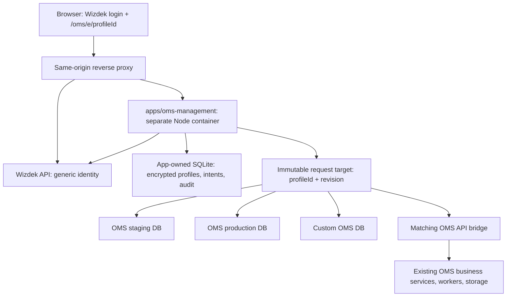

> Superseded architecture (2026-11-14): user requested a native `apps/app` route at `/works/oms-management`, under Works → OMS management, using the shared Wizdek shell and design system. See [native-route migration](./native-route-migration.md). Earlier standalone-app/deploy evidence below is historical.

> Implementation update (2026-11-14): app-local parameterized pg queries/runtime probes replace the proposed duplicate Prisma client; bounded 50 MB download buffering and durable recovery tombstones are documented in [implementation-report.md](./implementation-report.md). All other trust boundaries remain.

# Architecture và contracts

## 1. Ranh giới sản phẩm
Roots: `WIZDEK=/Volumes/anh.nguyen/Projects/wizloft/shopify-toolkit`; `OMS=/Volumes/anh.nguyen/Projects/b8/project-evisu-oms-v2`. Paths không có prefix là tương đối với WIZDEK. Các file Create trong pha là đề xuất, chưa tồn tại.



Độc lập ở cấp deploy và ownership, không phải không có dependency: shared login yêu cầu Wizdek identity service hoạt động. Nếu identity unavailable thì management từ chối request; OMS DB outage không được làm ngừng login Wizdek. Xóa management không thay đổi database/auth của Wizdek.

### Cây app đề xuất
```text
apps/oms-management/
  app/                         # Next routes dưới basePath /oms
  components/                  # Shell, switcher, editors, diagnostics
  lib/                         # Client query keys, redacted DTOs
  server/
    identity/                  # HTTP introspection; app-local access policy
    profiles/                  # Validation, encryption, versioning
    target/                    # Request context, compatibility, pool lifecycle
    db/                        # Parameterized queries/OMS client only
    services/                  # Read models và pure-setting mutations
    oms-api/                   # Typed command adapter
    audit/                     # Intents, reconciliation, redaction
    storage/                   # App-local SQLite repositories
  prisma/oms/schema.prisma     # Pinned OMS model snapshot; generate only
  generated/oms/               # App-specific output, never shared @prisma/client output
  migrations/control/          # Only app-owned SQLite schema
  scripts/ tests/ deploy/ docs/
  package.json next.config.ts turbo.json Dockerfile .env.example
```

### Integration allowlist ngoài app
- `pnpm-lock.yaml`: workspace dependency resolution. Không thêm OMS models vào `packages/database`.
- `packages/api/src/identity-route.ts` và mount trong `packages/api/src/app.ts`: generic Hono `GET /api/identity`, không đi qua oRPC để giữ response headers. `packages/auth/src/session.ts` thêm helper `getCurrentSessionWithHeaders` giữ active-status/email checks; existing `getCurrentSession` vẫn giữ return contract. Không thêm OMS logic/auth tables; tests ở hai package. Endpoint tồn tại độc lập sau uninstall.
- `.github/workflows/oms-management.yml`: build/test/deploy wiring riêng, không thêm secrets vào pipeline chung.
- Gateway owner: người triển khai pha 7. Create app-local `deploy/Caddyfile` và `deploy/compose.yml` mẫu có `/oms` + `/oms/*` route trước Wizdek catch-all, upstream `oms-management:4010`; giữ prefix cho Next basePath. Verify actual gateway path trên host trước rollout; merge vào config owner thật, ghi exact path/diff/rollback trong release evidence.
- Optional launcher URL: chỉ link/config, không import component hoặc service OMS. Không bắt buộc sửa navigation hiện có để hoàn tất app.
- `boundaries.config.json`: declarative `forbiddenPackageImports['@repo/oms-management']` wiring; dùng checker hiện hữu, không viết parser khác. Uninstall xóa entry này. Không sửa root env/Turbo để đưa OMS secrets vào app khác. Dùng `apps/oms-management/turbo.json`, runtime env riêng. Root dev hiện có preflight DB Wizdek; tài liệu cho app dùng `pnpm --filter @repo/oms-management dev` trực tiếp.
- Không import `@repo/api`, `@repo/auth/server`, `@repo/database`, `@repo/shopify`, `@repo/flows`, `@repo/jobs`, `@repo/database-tools`. Có thể dùng UI subpath thuần sau transitive audit, config TypeScript ở build time. Không tạo `packages/oms-*`.

## 2. Shared login và authorization
- Default deployment: cùng HTTPS origin với Wizdek; `/oms` basePath ở management, `/api` thuộc Wizdek, management endpoints là `/oms/api/*`. Proxy phải route `/oms` trước catch-all app; assets/RSC và callback đều kiểm chứng.
- Khi chưa login: về `/sign-in?callbackUrl=/oms/...`; callback chỉ relative path đã validate. Không copy auth secret hay đọc DB Wizdek từ app.
- Management backend gọi fixed trusted Wizdek identity origin với `renew=false`, forward chỉ session cookie được phép; không forward đến OMS/custom endpoints. App shell gọi `/api/identity` trực tiếp cùng origin khi mount/focus và mỗi 10 phút khi đang active để renew trong browser response. Hono endpoint lấy Better Auth response headers, append từng Set-Cookie nguyên attributes; helper verify pinned returnHeaders/disableRefresh behavior. RSC không cố set cookie. no-store/timeout; không tin userId từ browser.
- Generic identity phải dùng `getCurrentSession` để giữ kiểm tra ACTIVE/email verification hiện có; raw Better Auth get-session không đủ để giả định status gate.
- App-local server-config policy theo immutable Wizdek user ID × profile/safetyClass × capabilities: `read`, `profiles:edit`, `settings:write`, `commands`, `secrets:reveal`. Default deny, allowlisted user chỉ có read trừ capability được cấp rõ. Profile edit không tự cấp production write. Không tạo OMS role hoặc shared permission catalog; policy thay đổi là deployment config.
- Mọi endpoint read/write/download/profile-test đều kiểm tra session và allowlist. Mutation yêu cầu cùng origin + CSRF protection; GET không gây side effect. Credentials không nằm trong query string/cache/browser storage.
- Nếu cần public origin riêng sau này: phải có SSO exchange hoặc cookie-domain design riêng; không tuyên bố shared login tự hoạt động giữa hai domain. Chưa xây lựa chọn đó.

## 3. Profiles và storage
```ts
type ProfileId = string; // opaque stable ID, not hostname or editable label
type TargetRevision = number;
type OmsProfilePublic = {
  id: ProfileId;
  revision: TargetRevision;
  name: string;
  preset: 'staging' | 'production' | null;
  safetyClass: 'staging' | 'production' | 'custom';
  capabilities: Array<'read' | 'settings:write' | 'commands' | 'secrets:reveal'>;
  health: 'unknown' | 'healthy' | 'unreachable' | 'incompatible';
};
```
Private revision gồm DB connection/TLS settings, canonical endpoint identity, optional API URL/credentials, configured OMS account scope, expected deployment identity và compatibility evidence. Chỉ server thấy phần này.

- `OMS_STAGING_DATABASE_URL`, `OMS_STAGING_API_URL`, `OMS_STAGING_SERVICE_TOKEN`; tương tự `OMS_PRODUCTION_*` seed hai preset. Không ghi đè override trong storage mỗi lần restart.
- `OMS_CONTROL_DB_PATH`, `OMS_PROFILE_ENCRYPTION_KEY`, `OMS_ALLOWED_WIZDEK_USER_IDS`, `OMS_ACCESS_POLICY_JSON`, `WIZDEK_IDENTITY_ORIGIN`, `OMS_ALLOWED_DB_HOSTS`, `OMS_ALLOWED_API_ORIGINS` là server-only app config. Key encryption độc lập key Shopify/OMS.
- SQLite trên persistent local volume, một writer app instance. Tables `connection_profiles`, `connection_profile_revisions`, `management_operations`, `management_audit`, `backup_evidence`; không chứa auth users/sessions. Backup SQLite bằng API hỗ trợ snapshot/WAL, không copy file đang ghi tùy ý.
- UI có list/test/create/edit/disable/reset-preset. Password/token write-only: để trống là giữ nguyên, explicit replace/clear; không prefill plaintext. Edit tạo revision mới sau validation + test, không overwrite cấu hình đang có operation chạy. Reset về preset cũng tạo revision mới, invalidate confirmation.
- Custom DB mặc định read-only, API optional. Không tự dùng API production cho custom DB. Chỉ bật write/commands sau compatible schema, backup, explicit enable và binding checks. Tên/safetyClass không cho phép giảm mức bảo vệ của endpoint production đã biết.
- Connection test chỉ kiểm tra kết nối/schema/select identity; không migrate, seed, ghi marker hoặc chạy job. Credentials submit chỉ qua HTTPS POST, không log request body. Cấu hình target được phép truy cập trong host/origin allowlist do deploy sở hữu, không UI-editable.
- Chặn SSRF: validate protocol/port/host, cấm credential trong API URL, redirect disabled, kiểm tra DNS/IP và IPv4/IPv6 theo allowlist lúc mở kết nối; private DB được cho phép theo host cụ thể, không wildcard private network. Test DNS rebinding và loopback/metadata denial. Không upload TLS file qua filesystem path tùy ý.

## 4. Immutable routing và cache
- URL `/oms/e/<profileId>/...` là selection từng tab. Không dùng cookie/global `currentDatabase` hoặc sửa `process.env.DATABASE_URL`. Không auto chọn production khi lỗi; initial selection staging nếu tồn tại.
- Mọi request đọc/ghi OMS target bắt buộc `profileId` và `revision` (identity/profile catalog endpoints có contract riêng); backend resolve committed revision sau authorization. Context bất biến gồm actorId, profileId, revision, accountScope, db client, API client, requestId; truyền xuống từng repository/service.
- Pool cache theo `{profileId,revision}`; bounded reuse + lease/refcount. Tách interactive lease và recovery lease: revision retired chặn operation mới, nhưng operationId đã accepted được reacquire exact old revision để status/audit reconciliation. Giữ encrypted credentials đến terminal + retention, reserve pool capacity cho recovery. Drain không disconnect request đang chạy; vượt cap báo lỗi, không fallback.
- Query key: `['oms', actorId, profileId, revision, accountScope, resource, filters]`; fresh QueryClient per SSR request, provider riêng client-side. Không dùng shared Wizdek QueryClient. Không persist secret DTO. Server HTTP/RSC/data fetch: dynamic/no-store cho dữ liệu OMS và identity.
- Switch: chặn submit trong chuyển tiếp; prompt discard unsaved edits; cancel reads, reset forms/modals/selection/confirmation, navigate, fetch new revision. Không giữ previousData giữa profiles. Response revision cũ không được render vào target mới.
- Mutation envelope: `{profileId, revision, accountScope, operationId, action, expectedVersion, payload}`. Resolve/check lại trước khi dispatch; conflict là 409, không silent retarget. Operation đã chạy không bị cancel vì đổi tab; UI hiện target gốc và kết quả trong operation history.
- Edit profile đồng thời với dispatch: transaction/CAS giành dispatch lease trên revision. Revision update không chuyển target của operation đã accepted; có in-flight write thì UI chặn đổi binding đến khi trạng thái terminal hoặc operator xử lý unknown.

## 5. DB/API binding, schema và commands
- Backend reads schema compatibility từ `information_schema`/migration metadata cần thiết; capability-specific probes. App pin snapshot vào OMS commit, không `db push` hoặc `migrate deploy` trên target. Hai stages có thể khác schema: feature thiếu column/table phải unavailable rõ, không crash toàn app.
- API bridge `/api/v1/management/*`, fixed endpoints. OMS-owned provisioning script tạo random UUID ở SiteSetting key `management.databaseIdentity` sau backup; không cần auth schema change. API env `OMS_MANAGEMENT_EXPECTED_DB_ID` và `OMS_MANAGEMENT_DEPLOYMENT_ID` độc lập từng deployment. Startup/each write verifies DB marker == expected ID. Restored clone phải rotate marker + new env ID trước command enable; connection test không tự tạo marker.
- Binding gate so sánh direct DB marker + expected ID/deployment + fingerprint của normalized datasource endpoint/port/database thực sự API đang dùng (server computes từ config, không lấy request). Management computes fingerprint từ profile; exact mismatch denies. DNS alias phải được operator verify/configure canonical mapping, không auto-equate; copied marker trên endpoint khác vẫn fail fingerprint. Không chứng minh được thì read-only/unverified; test stage DB + prod API, clone marker, aliases, mislabelled profile.
- Mỗi deployment OMS có credential bridge riêng, rotate/revoke được, HTTPS, scope theo action/account, rate limit. Browser không thấy credential. Bridge không nhận user cookie Wizdek, không dùng role `G_ADMINISTRATOR`; management server forward actor identity đã xác thực trong authenticated service request.
- Bridge giữ logic nghiệp vụ đã có ở OMS. Adapter/UI/management orchestration ở Wizdek app; không chuyển Shopify/DHL encryption keys, queue workers hay fulfillment state machine sang Wizdek.
- DB-local commands có mandatory durable receipt: unique operationId/payload hash + run/config mutation + audit trong cùng transaction, wake scheduler sau commit. Status-query theo operationId. Remote side effect không có downstream idempotency có thể unknown; không auto-retry. Job/run ID pinned profile revision và execution deployment.

## 6. Audit, backups và production
- Trước write: lưu durable intent và backup/snapshot có restore procedure cho dữ liệu bị sửa; migrations/data repair cần verified DB backup trước execution. Credentials chỉ trong backup được mã hóa, không audit UI.
- Direct setting write và OMS AuditLog insert cùng transaction, CAS theo version/value. `AuditLog.actorId` là FK OMS User: không đặt Wizdek user ID vào đó. Dùng actorId=null, metadata bắt buộc `externalActor:{issuer:'wizdek',subject:stableUserId,displayNameSnapshot}`, operationId, profileId/revision và redacted before/after. Bridge chỉ nhận subject từ authenticated management service envelope; browser không tự gán actor; reconciliation kiểm tra subject.
- App audit ghi connection changes, read-secret/download, denied actions và operation lifecycle. Không thể transaction atomically giữa SQLite và target DB: persist intent trước, OMS audit là receipt; nếu response/local finalize lỗi thì reconcile qua operationId, không báo chắc chắn failure/success sai.
- Production luôn có badge/text cố định; read không hỏi lại. Write confirmation hiển thị target, account, action, before/after; bind operation + revision + payload hash và hết hạn ngắn. Sau switch/edit phải confirm lại. Không bật production write bằng đổi tên profile.
- Commands backup gate tham chiếu backup có phạm vi/restore evidence phù hợp; không tuyên bố backup DB có thể undo email/Shopify/DHL side effects. Rollback các thao tác đó theo contract nghiệp vụ, không chạy SQL đảo chiều.

## 7. Extension trace và trade-offs
- Variant thứ hai thực tế: production so với staging. Contract vẫn ProfileId + revision + capabilities; thay credentials, DB/API binding, account scope, schema compatibility và production policy. Chứng minh bằng 2 Postgres fixtures với cùng IDs nhưng dữ liệu khác.
- Variant user yêu cầu: custom OMS DB. Không đổi services/screens; thêm profile revision + pool. Nếu thiếu API thì command capability unavailable; không thêm plugin registry hoặc factory đa engine.
- Shared identity qua HTTP phụ thuộc availability Wizdek, đổi lại không giữ duplicate auth secrets/DB client. Failure trước tiên: proxy/cookie sai hoặc identity outage; response fail-closed và vẫn cho Wizdek hoạt động.
- SQLite control storage giảm dependency dùng chung nhưng giới hạn single-instance + durable disk; deploy one Node process/one replica, stop old before starting new (Recreate/no surge), shared persistent volume, startup exclusive owner/migration lock; second instance fails readiness. Pool cap tính theo process thực tế; nếu deployment cần autoscale/serverless ephemeral thì dừng để chuyển riêng storage app sang Postgres, giữ repositories/contracts, không dùng shared database package.
- Best approach vẫn là app riêng trong Wizdek theo yêu cầu; cải tiến là environment profile có version thay vì đổi connection string toàn process. Chi phí: pool lifecycle, profile store, isolation tests và một generic identity endpoint.

## 8. DB impact và live rollout
- Shared login không sửa OMS users/sessions/passwords hoặc auth schema, không sync user. Generic identity helper chỉ thay đổi code Wizdek.
- Profile switching/diagnostic reads không migrate OMS DB. Binding provisioning thêm một SiteSetting key per DB sau backup; command receipt có additive OMS table/migration riêng. User đã chọn role cutover sau chuyển đổi đầy đủ; thay đổi assignments thuộc bước đó, không phải điều kiện đăng nhập.
- Same-origin cookie đặt management trong cùng auth trust zone Wizdek; đây là isolation code/deploy, không phải isolation chống compromise giữa hai frontend. Redact Cookie/Set-Cookie/Authorization toàn bộ access/error/trace logs, không expose headers. Audience-limited SSO token là redesign nếu cần trust boundary chặt hơn, chưa tự thêm hệ thống đó.
- Direct DB activation phải kiểm tra privilege ceiling: dedicated read role không superuser/createrole/createdb/schema DDL, không đọc session/account/password/token/secret columns; cho phép column-level SELECT User.id/name phục vụ actor display nếu cần; write role chỉ thêm grants cần cho maintenance/audit. Reject overprivileged profile ở activation, cho test báo rõ thiếu/thừa quyền. Không cần quyền owner để test một custom OMS DB.
- Expand/contract OMS: release A additive schema compatible old binary, B bridge code/capability gate, contract cleanup ở release riêng sau hết old binary/retention. Deploy script migrate trước container replace; rollback image phải chạy được với expanded schema. Không drop/rename enum cùng cutover.
- Live order: prepare scripts/rehearse → deploy bridge+management staging → parity/write/recovery UAT → production dark/read-only deploy/health → role/routes cutover đã xác nhận sau khi toàn bộ feature parity đạt yêu cầu. Không retire trước khi replacement live.
- Uninstall: freeze writes → snapshot → drain/reconcile accepted/running/unknown → terminal ledger → revoke/grants → remove wiring. Unknown giữ status/read-only recovery và encrypted revision/key, chưa final decommission.
